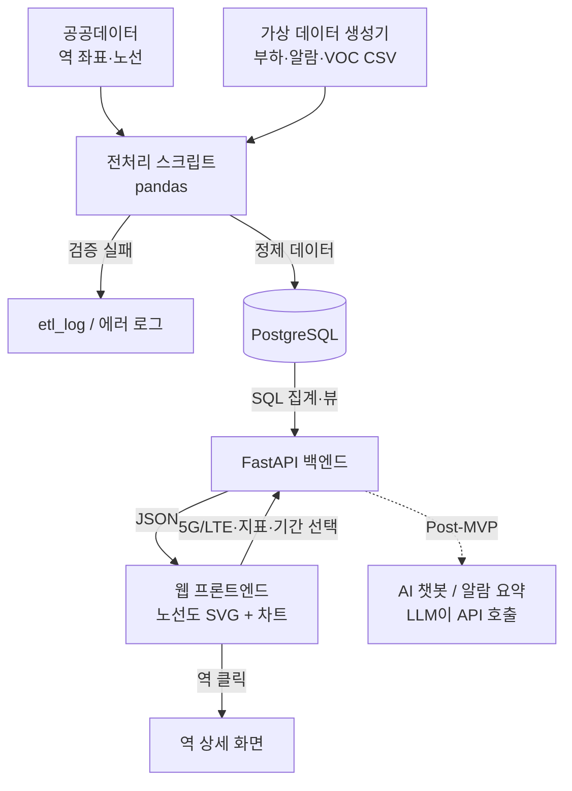

# PRD: 수도권 지하철 무선망 모니터링 웹서비스

**작성일**: 2026년 11월 8일
**버전**: 2.0 (RENEWAL, MVP 계획)
**원본 자료**: (261102) 의뢰서 v1 중 프로젝트 내용만 반영 (과외·수업 관련 내용 제외)
**목표 완성일**: 8주(2개월) 안에 MVP 완성 → 이후 기능 추가·수정 계속

---

## 1. 개요 및 목적

수도권 지하철 노선도에서 **5G/LTE를 고르면 VOC·부하율·장비알람을 역과 터널 구간별로 보여주는 웹서비스**를 만든다. 역을 누르면 대합실·승강장 RU, 앞뒤 터널 중계기, 통신실 DU까지 장비 단위로 내려가서 상태를 확인할 수 있다.

**주요 목적:**
- 장애·민원이 생겼을 때 **원인 역·터널 구간을 빨리 찾는** 운영 도구 구현
- 하나의 노선도에서 기술(5G/LTE)·지표(VOC/부하율/알람)만 바꿔 같은 역·구간을 여러 관점으로 확인
- Python·SQL 데이터 처리, 백엔드 API, 시각화, AI 기능, 배포까지 갖춘 **금융권 디지털/AI 직무 지원용 포트폴리오** 확보
- 2달 뒤에도 계속 고치고 운영할 수 있는 구조(Git·Docker·클라우드)로 구축

---

## 2. 문제 정의

### 현재 상황
- **데이터 분산**: VOC, 부하율, 장비알람이 서로 다른 시스템·파일에 흩어져 있어 한 번에 보기 어려움
- **위치 파악 지연**: 민원이나 알람이 생겨도 어느 역·어느 터널 구간인지 지도 위에서 바로 보이지 않음
- **원인 연결의 어려움**: "VOC 급증 ↔ 같은 시간대 장비 알람·부하율 상승" 같은 상관관계를 사람이 수작업으로 맞춰봐야 함
- **터널 구간 사각지대**: 역 단위 현황은 보이더라도 역간 터널 중계기 상태는 놓치기 쉬움

### 비전
지하철 무선망 품질 업무 경험을 **데이터 기반 모니터링 서비스**로 직접 구현하고, 같은 구조를 은행의 운영 모니터링·이상거래 탐지로 확장할 수 있음을 보여준다.

---

## 3. 목표 및 성공 지표

### 1차 MVP 목표 (8주)
- ✅ 수도권 전체 노선도를 공공데이터 역 좌표로 직접 그리기
- ✅ 5G/LTE × 지표(VOC·부하율·장비알람) × 기간(24시간/7일/30일) 선택
- ✅ 핵심 화면 5개 완성: ① 메인 ② VOC ③ 부하율 ④ 장비알람 ⑤ 역 상세(터널 장비)
- ✅ DB 저장 + SQL 집계 + 백엔드 API + 클라우드 배포

### 성공 지표
| 지표 | 목표값 |
|------|--------|
| 원인 역·구간 파악 시간 | 알람/VOC 발생 후 화면 3클릭 이내로 장비 단위 도달 |
| 노선도 화면 로딩 | <3초 (지표·기술 전환 <1초) |
| 데이터 커버리지 | 수도권 전 노선 역·터널 구간 100% 표시 |
| 데이터 정합성 | 가상 데이터 적재 시 검증 오류 0건 (실패 행은 로그로 분리) |
| 배포 | 공개 URL로 접속 가능, Docker 한 번으로 재현 가능 |

---

## 4. 사용자 및 이해관계자

### 주요 사용자
- **무선망 운영 담당자**
  - 목적: 장애·민원 발생 시 원인 역·구간·장비를 빠르게 특정
  - 사용 상황: 평시 현황 확인, 알람 발생 시 위치 추적, VOC 급증 시 원인 확인
  - 필요 정보: 미해제 알람, 부하율 높은 역·구간, VOC 많은 역, 역별 장비 상태

### 2차 이해관계자 (포트폴리오 관점)
- **채용 담당자·면접관** (NH농협은행 AI·디지털/AI기획·운영, IBK기업은행 디지털)
  - 확인하고 싶은 것: Python·SQL 데이터 처리, DB 설계, API 연계, 생성형 AI 활용, 배포·운영 역량

---

## 5. 사용자 여정 (User Journey)

### 기본 조회 흐름
```
1. 노선도 메인 화면 진입 (기본값: 5G, 최근 24시간)
2. 5G 또는 LTE 선택
3. 지표 선택 (VOC · 부하율 · 장비알람)
4. 역(원)·터널 구간(선)이 지표 기준 색/크기로 표시됨
5. 오른쪽 패널에서 요약·TOP 목록 확인
6. 역 클릭 → 역 상세 (장비 목록, 시간대별 그래프, 해당 역 VOC)
```

### 장애 대응 흐름 (알람 기점)
```
1. 장비알람 지표 선택 → 미해제 알람 목록 확인
2. 알람 클릭 → 해당 역으로 지도 이동 + 같은 시간대 VOC·부하율 함께 표시
3. 역 상세 진입 → RU / 중계기(REP) / DU 중 어느 장비인지 확인
4. "21:40 이후 VOC 6건 집중 → RU-03·REP-12 알람과 시간대 일치" 같은 연관 정보 확인
```

### 민원 대응 흐름 (VOC 기점)
```
1. VOC 지표 선택 → 원 크기로 역별 민원 건수 확인
2. VOC 많은 역 TOP 5와 유형별 비율(속도저하·끊김·접속불가·기타) 확인
3. 역 클릭 → 같은 시간대 부하율·알람과 비교해 원인 추정
```

### 에러 처리 흐름
```
1. 데이터 적재 시 형식 오류(시각 형식, 없는 역명/장비ID 등)
   → 해당 행은 적재 제외, 에러 로그에 행 번호·사유 기록
2. 측정값 누락 구간
   → 지도에서 회색(데이터 없음)으로 표시, 집계에서는 제외
3. API 오류
   → 화면에 "데이터를 불러오지 못했습니다" + 재시도 버튼
```

---

## 6. 기능 요구사항

### 6.1 공통 조작 영역 (상단 바)
- [ ] **기술 선택**: 5G / LTE 토글 → 같은 지도에 해당 망 데이터로 교체
- [ ] **지표 선택**: VOC / 부하율 / 장비알람
- [ ] **기간 선택**: 최근 24시간 / 7일 / 30일
- [ ] 선택 상태는 URL 쿼리에 반영 (예: `?tech=5G&metric=load&period=24h`) → 새로고침·공유 시 유지

### 6.2 ① 메인 – 노선도
- [ ] 공공데이터 역 좌표로 수도권 전 노선을 SVG로 직접 렌더링 (노선도 이미지는 저작권 문제로 사용하지 않음)
- [ ] 역 = 원, 역간 터널 구간 = 선
- [ ] 확대/축소·이동(pan/zoom), 호선 필터
- [ ] 오른쪽 요약 패널: VOC 건수, 부하율 85% 이상 역 수, 미해제 알람(Critical 수), 관리 장비 수(RU·DU·중계기)

### 6.3 ② VOC – 역별 민원 건수
- [ ] 역 원 크기 = VOC 건수, 원 안 숫자 = 건수
- [ ] VOC 많은 역 TOP 5 (순위, 역, 건수, 주요 유형)
- [ ] 유형별 비율 막대 (속도저하 / 끊김 / 접속불가 / 기타)

### 6.4 ③ 부하율 – 역·터널 구간 색상
- [ ] 기준: **70% 미만 초록, 70~85% 노랑(주의), 85% 이상 빨강(위험)**
- [ ] 역(원)과 터널 구간(선) 모두 색 적용
- [ ] 부하 높은 구간 목록 (구간, 종류: 역사/터널, 피크 부하율)
- [ ] 선택한 역·구간의 시간대별 부하율 그래프 (85% 기준선 표시)

### 6.5 ④ 장비알람 – 역·터널 알람 위치
- [ ] 등급별 표시: Critical(빨강) / Major(주황) / Minor(노랑), 터널 장비는 `T` 표식
- [ ] Critical 알람 발생 역은 강조(펄스/테두리)
- [ ] 미해제 알람 목록 (등급, 위치, 장비ID, 발생 시각)
- [ ] 알람 클릭 → 해당 역으로 지도 이동 + 같은 시간대 VOC·부하율 함께 표시

### 6.6 ⑤ 역 상세 – 역별 터널 장비
- [ ] 역사 구조도: 대합실(B1) RU, 승강장(B2) RU, 통신실 DU
- [ ] 앞뒤 터널 구간 중계기(REP)와 역에서의 거리(km)
- [ ] 장비 박스 색 = 알람 상태(초록 정상 / 주황 Major / 빨강 Critical), 터널 선 색 = 구간 부하율
- [ ] 장비 현황 표: 장비ID, 위치, 부하율, 상태
- [ ] 이 역 VOC 건수 + 알람과 시간대가 겹치는 VOC 자동 표시
- [ ] "노선도로 돌아가기"

### 6.7 데이터 적재·전처리 (pandas)
- [ ] CSV 적재 스크립트: 형식 검증 → 정제 → DB 저장
- [ ] 시각 형식 통일, 중복 제거(같은 장비·같은 측정시각), 역명/장비ID 마스터 매칭
- [ ] 이상치 처리: 부하율 0~100% 범위 밖 값 플래그, 누락 구간 표시
- [ ] 집계 테이블/뷰: 역별·구간별·시간대별 부하율, 역별 VOC 건수, 미해제 알람

### 6.8 백엔드 API (HTTP)
| Method | Endpoint | 설명 |
|--------|----------|------|
| GET | `/api/lines` | 호선·역·구간 좌표 (노선도 렌더링용) |
| GET | `/api/summary?tech&period` | 오른쪽 요약 패널 수치 |
| GET | `/api/voc?tech&period` | 역별 VOC 건수, TOP 5, 유형 비율 |
| GET | `/api/load?tech&period` | 역·구간별 부하율, 상위 구간 |
| GET | `/api/load/timeseries?target_id&tech&period` | 시간대별 부하율 |
| GET | `/api/alarms?tech&status=open` | 알람 목록·위치 |
| GET | `/api/stations/{id}?tech&period` | 역 상세 (장비·부하·알람·VOC) |

> AI 챗봇(Post-MVP)도 이 API를 그대로 호출하는 구조로 설계한다.

---

## 7. 데이터 요구사항

### 7.1 데이터 항목
| 구분 | 항목 |
|------|------|
| 위치 | 호선, 역명, 역 좌표, 구간(역간 터널) |
| 장비 | 장비ID, 장비종류(RU/DU/중계기), 기술(5G/LTE), 설치 위치(대합실/승강장/터널/통신실) |
| 부하 | 측정시각, 부하율(%), 접속자 수 |
| 알람 | 등급(Critical/Major/Minor), 발생 시각, 해제 시각 |
| VOC | 접수시각, 유형, 위치 |

### 7.2 값의 형태와 기준
- **수집 주기**: 15분 또는 1시간 (MVP 권장: 1시간 → 데이터량 확인 후 15분 검토)
- **데이터 기간**: 3개월, CSV
- **기준값**: 부하율 70% 이상 주의(노랑), 85% 이상 위험(빨강), Critical 알람 시 역 강조
- **노선도**: 공공데이터 역 좌표로 직접 그림
- **데이터 출처**: 실제 회사 데이터 대신 **형식만 참고한 가상 데이터** (화면 숫자·장비 ID 모두 가상)

### 7.3 DB 스키마 (초안)
```
lines            (line_id PK, name, color)
stations         (station_id PK, name, lat, lon)
line_stations    (line_id FK, station_id FK, seq)           -- 환승역 다대다 처리
segments         (segment_id PK, line_id FK, from_station FK, to_station FK, length_km)
equipment        (equip_id PK, type[RU/DU/REP], tech[5G/LTE],
                  station_id FK NULL, segment_id FK NULL,
                  location[대합실/승강장/터널/통신실], distance_km)
load_measurements(id PK, equip_id FK, measured_at, load_pct, user_count)
alarms           (alarm_id PK, equip_id FK, severity, raised_at, cleared_at NULL)
voc              (voc_id PK, received_at, type, tech, station_id FK, segment_id FK NULL)
etl_log          (id PK, file_name, loaded_at, rows_ok, rows_failed, message)
```
- 미해제 알람 = `cleared_at IS NULL`
- 역/구간 부하율 = 소속 장비 부하율의 최대값(또는 평균) — 기준 확정 필요 (14장)

---

## 8. 데이터 흐름도



---

## 9. 기술 스택 제안 및 선정

### 후보 비교
| 항목 | **Option 1: Streamlit** | **Option 2: FastAPI + React (추천)** | **Option 3: Django + 템플릿** |
|------|------|------|------|
| 노선도 클릭·확대 등 인터랙션 | 제한적 | 자유로움 (SVG/D3) | 중간 |
| 백엔드 API(HTTP) 분리 | 없음 | 명확함 → AI 챗봇 연계 쉬움 | 가능 |
| 학습 범위 (프론트·백·DB·배포) | 좁음 | 전부 포함 | 대부분 포함 |
| 직무역량 연결 (API 연계·서비스 구조) | 약함 | 강함 | 보통 |
| MVP 난이도 | 하 | 중상 | 중 |

### 🎯 최종 선정: FastAPI + React + PostgreSQL

**선정 근거:**
1. **노선도 인터랙션**: 역·터널 구간 클릭, 색·크기 변경, 확대/축소를 위해 SVG 직접 제어가 필요 → Streamlit으로는 한계
2. **API 분리**: 화면과 데이터를 HTTP API로 연결하는 구조가 그대로 "인터페이스 연계 개발" 역량이 되고, AI 챗봇이 같은 API를 호출하게 만들 수 있음
3. **Python·SQL 중심 유지**: 데이터 처리·집계는 전부 Python(pandas)과 SQL로 처리
4. **운영 지속성**: Docker로 묶어 클라우드에 배포, 2달 이후 계속 수정 가능

### 상세 기술 스택
```
Frontend:
  - React + next.js (TypeScript)
  - 노선도: SVG + D3.js (좌표 → 화면 변환, zoom/pan)
  - 차트: Recharts 또는 Chart.js (시간대별 부하율, 유형 비율)

Backend:
  - Python 3.11+
  - FastAPI (HTTP API), Pydantic (응답 스키마)
  - SQLAlchemy 2.x + 직접 작성 SQL (집계 쿼리)

Data:
  - pandas (전처리·집계·이상치), numpy
  - 가상 데이터 생성 스크립트 (Python)

Database:
  - PostgreSQL 16 (로컬은 Docker 컨테이너)

DevOps:
  - Git / GitHub (이슈·PR)
  - Docker, docker-compose (frontend / backend / db)
  - 클라우드 배포 (AWS EC2)

Post-MVP AI:
  - LLM API 기반 챗봇 / 알람 요약
  - 추가: 오픈웨이트 LLM + 서빙 프레임워크(Ollama, vLLM 등)로 교체 실험
```

---

## 10. 폴더/파일 구조 제안

```
subway-ran-monitor/
├── README.md
├── docker-compose.yml
├── .env.example
├── .gitignorego
│
├── data/
│   ├── public/                  # 공공데이터 역 좌표·노선 원본
│   ├── synthetic/               # 생성된 가상 CSV (부하·알람·VOC)
│   └── logs/                    # 적재 에러 로그
│
├── etl/
│   ├── generate_synthetic.py    # 가상 데이터 생성기
│   ├── load_stations.py         # 역·노선·구간 마스터 적재
│   ├── load_measurements.py     # 부하·알람·VOC 적재
│   ├── cleaner.py               # 형식 통일·중복 제거·이상치 플래그
│   └── validator.py             # 필수 컬럼·마스터 매칭 검증
│
├── db/
│   ├── schema.sql               # 테이블 정의
│   ├── views.sql                # 집계 뷰 (역별·구간별·시간대별)
│   └── seed/                    # 초기 데이터
│
├── backend/
│   ├── Dockerfile
│   ├── requirements.txt
│   └── app/
│       ├── main.py              # FastAPI 진입점
│       ├── db.py                # DB 연결
│       ├── models.py            # SQLAlchemy 모델
│       ├── schemas.py           # 응답 스키마
│       ├── routers/
│       │   ├── lines.py
│       │   ├── summary.py
│       │   ├── voc.py
│       │   ├── load.py
│       │   ├── alarms.py
│       │   └── stations.py
│       └── queries/             # 집계 SQL
│
├── frontend/
│   ├── Dockerfile
│   ├── package.json
│   └── src/
│       ├── App.jsx
│       ├── api/                 # 백엔드 호출
│       ├── components/
│       │   ├── TopBar.jsx       # 5G/LTE·지표·기간 선택
│       │   ├── SubwayMap.jsx    # 노선도 SVG
│       │   ├── SidePanel.jsx    # 요약·TOP 목록
│       │   └── charts/
│       └── pages/
│           ├── MapPage.jsx      # ①~④ (지표만 전환)
│           └── StationDetail.jsx# ⑤ 역 상세
│
├── notebooks/                   # 탐색적 분석 (부하율 추이, 상관 분석)
└── tests/
    ├── test_cleaner.py
    ├── test_queries.py
    └── test_api.py
```

---

## 11. 단계별 개발 마일스톤 (8주 MVP 계획)

### 📅 1~2주차: 데이터 기반 구축
**목표**: 노선·역 마스터와 가상 데이터를 DB에 적재

- [ ] GitHub 저장소, 폴더 구조, docker-compose(PostgreSQL) 구성
- [ ] 공공데이터 역 좌표·노선 수집 및 정제 (환승역, 구간 순서 처리)
- [ ] DB 스키마 설계 (`schema.sql`)
- [ ] 장비 마스터 생성 (역별 RU/DU, 구간별 중계기)
- [ ] 가상 데이터 생성기: 부하율(시간대 패턴 포함), 알람, VOC (3개월)
- [ ] 적재 스크립트 + 검증·에러 로그

**산출물**: 적재된 DB, ERD, 가상 데이터 CSV

---

### 📅 3주차: SQL 집계·분석
**목표**: 화면에 필요한 수치를 SQL로 뽑아낼 수 있음

- [ ] 역별·구간별·시간대별 부하율 집계 뷰
- [ ] 역별 VOC 건수·유형 비율, TOP 5
- [ ] 미해제 알람, 등급별 집계
- [ ] notebooks에서 부하율 추이·VOC↔알람 시간대 일치 탐색

**산출물**: `views.sql`, 분석 노트북

---

### 📅 4주차: 백엔드 API
**목표**: 6.8의 API 전부 동작

- [ ] FastAPI 프로젝트 구성, DB 연결
- [ ] `/api/lines`, `/summary`, `/voc`, `/load`, `/alarms`, `/stations/{id}` 구현
- [ ] API 문서(Swagger) 확인, 기본 테스트

**산출물**: 동작하는 API + 자동 문서

---

### 📅 5~6주차: 프론트엔드 – 노선도와 지표 화면
**목표**: 화면 ①~④ 완성

- [ ] React 프로젝트, 상단 바(기술·지표·기간)
- [ ] 좌표 기반 노선도 SVG 렌더링, zoom/pan
- [ ] ② VOC 원 크기, ③ 부하율 색상(70/85 기준), ④ 알람 표시
- [ ] 오른쪽 패널(요약·TOP·목록), 시간대별 부하율 그래프
- [ ] 알람 클릭 → 해당 역 이동

**산출물**: 화면 ①~④

---

### 📅 7주차: 역 상세 + 연관 정보
**목표**: 화면 ⑤ 완성

- [ ] 역사 구조도(대합실·승강장 RU, 통신실 DU, 앞뒤 터널 REP)
- [ ] 장비 현황 표, 이 역 VOC
- [ ] 알람과 시간대가 겹치는 VOC 표시

**산출물**: 화면 ⑤

---

### 📅 8주차: 배포·마무리
**목표**: 공개 URL로 접속 가능한 MVP

- [ ] frontend/backend Dockerfile, docker-compose 통합
- [ ] 클라우드 배포, 환경변수 정리
- [ ] 성능 확인(로딩 <3초), 버그 수정
- [ ] README(소개·아키텍처·실행 방법·화면 캡처), 시연 시나리오 작성

**산출물**: 배포 URL, README, 시연 시나리오

---

### 📊 마일스톤 진행도
```
Week 1-2: ████░░░░░░░░░░░░ (데이터 기반)
Week 3  : ██████░░░░░░░░░░ (SQL 집계)
Week 4  : ████████░░░░░░░░ (API)
Week 5-6: ████████████░░░░ (노선도·지표 화면)
Week 7  : ██████████████░░ (역 상세)
Week 8  : ████████████████ (배포)

MVP 완성 목표: 8주차 (2027년 1월 첫째 주 예정)
```

---

### ⏭️ Post-MVP 고도화 계획 (우선순위 순)

우선순위는 직무역량 연결 정도를 기준으로 한 초안이다.

| 우선순위 | 추가기능 | 연결 역량 |
|---|---|---|
| 1 | **AI 챗봇** (자연어 질문: "2호선 5G 부하 높은 역?") – LLM이 백엔드 API 호출 | 농협 생성형 AI·AI Agent, 인터페이스 연계 / IBK 인공지능서비스 |
| 1 | **일일 알람 요약 리포트** (LLM 요약) | 농협 생성형 AI / IBK 인공지능서비스 |
| 1 | **승하차 인원(공공데이터) ↔ 부하율 상관 분석** | IBK 빅데이터분석 |
| 2 | **부하율 급증·알람 이상 탐지** | 데이터 분석, 금융 이상거래 탐지와 같은 논리 |
| 2 | **시간대별 추이·기간 비교 그래프** | 빅데이터분석, UI/UX |
| 2 | **오픈웨이트 LLM으로 AI 기능 구동** | 농협 오픈웨이트 LLM·서빙 프레임워크 |
| 3 | **로그인·권한, 알림(메일/메신저)** | 서비스 운영 |
| 3 | **데이터 자동 갱신(스케줄러)** | IBK 빅데이터운영관리 |

---

## 12. 직무역량 연결 (포트폴리오 관점)

### NH농협은행 – AI·디지털 / AI기획·운영
| 공고 요구역량 | 이 프로젝트에서 보여줄 방법 |
|---|---|
| Python·SQL 데이터 처리 및 코드 개발 | VOC·부하율·알람을 DB에 넣고 SQL로 집계, pandas로 전처리 |
| 생성형 AI / AI Agent 서비스 기획·구축 | 자연어 질문 LLM 챗봇, 일일 알람 요약 리포트 |
| 인터페이스(HTTP, MCP 등) 연계 개발 | 백엔드 HTTP API로 화면·데이터 연결, 챗봇이 API 호출 |
| 오픈웨이트 LLM·서빙 프레임워크 | AI 기능을 오픈웨이트 모델로 구동 (추가기능) |
| 프라이빗 클라우드 클러스터 운영 | Docker로 묶어 클라우드 배포·운영 |
| Kubernetes 기반 AI 플랫폼 | 개념 수준 이해 (MVP 범위 밖) |
| 이해관계자 기술 커뮤니케이션 | PRD 작성, GitHub PR·코드리뷰, 진행 기록 |

### IBK기업은행 – 디지털 (NCS 세분류)
| 세분류 | 이 프로젝트에서 보여줄 방법 |
|---|---|
| 빅데이터분석 | 부하율 추이, VOC·알람 상관 분석, 노선도 시각화 |
| DB엔지니어링 | 역·장비·측정값·알람·VOC 테이블 설계와 SQL 조회 |
| 빅데이터운영관리 | 2달 이후 계속 수정·운영 (배포, 데이터 갱신) |
| UI/UX엔지니어링 | 운영 담당자 시나리오 기반 화면 흐름·대시보드 |
| 인공지능서비스기획·구현 | LLM 챗봇·알람 요약 기획과 구현 |

**연결 스토리**: 지하철 무선망 품질 업무 경험 → 데이터 기반 모니터링 서비스로 직접 구현 → 은행의 운영 모니터링·이상거래 탐지와 같은 구조로 확장 가능.

---

## 13. Out of Scope (이번 MVP 범위 밖)

1. ❌ **AI 챗봇·알람 요약** – MVP 5개 화면 완성 후 우선순위 1로 추가
2. ❌ **실제 회사 데이터 사용** – 보안상 형식만 참고한 가상 데이터로 진행
3. ❌ **실시간 스트리밍 수집** – MVP는 CSV 배치 적재, 자동 갱신은 Post-MVP
4. ❌ **로그인·권한·알림 발송** – 우선순위 3
5. ❌ **Kubernetes 운영** – 개념 이해 수준, Docker 단일 배포로 대체
6. ❌ **수도권 외 노선, 5G/LTE 외 기술(3G, Wi-Fi 등)**
7. ❌ **모바일 전용 화면** – 데스크톱 우선, 반응형은 기본 수준만

---

## 14. 리스크 및 제약사항

### 🚨 기술적 리스크
| 리스크 | 영향도 | 가능성 | 완화 방안 |
|--------|--------|--------|---------|
| 수도권 전체 노선도 좌표 렌더링이 복잡(겹침·환승역) | 높 | 높 | 실제 지리 좌표를 그대로 쓰고 확대/축소로 해결, 필요 시 일부 노선 먼저 완성 후 확장 |
| 측정 데이터량 과다 (장비 수 × 15분 × 3개월) | 중 | 중 | MVP는 1시간 주기, 집계 뷰·인덱스 활용 |
| 웹 프론트엔드 학습 부담 (입문 수준) | 높 | 높 | 화면 ①~④를 한 페이지에서 지표만 전환하는 구조로 단순화 |
| 가상 데이터가 비현실적이면 분석 의미 약화 | 중 | 중 | 출퇴근 피크, 장애 시 VOC 증가 등 패턴을 생성기에 반영 |

### 📋 데이터 제약
| 항목 | 현황 | 대응 |
|------|------|------|
| 노선도 저작권 | 공식 노선도 이미지 사용 불가 | 공공데이터 역 좌표로 직접 그림 |
| 실제 장비·민원 데이터 | 사용 불가 | 형식만 참고한 가상 데이터 |
| 역/구간 부하율 정의 | 장비별 값만 존재 | 최대값 vs 평균 기준 확정 필요 |

### 💼 일정·자원 제약
| 항목 | 제약 | 대응 |
|------|------|------|
| 기간 | 8주 MVP | 5개 화면에 집중, 나머지는 Post-MVP |
| 인력 | 1인 개발 (직장 병행) | 주차별 산출물 기준으로 범위 조정 |
| 비용 | 클라우드·LLM 비용 | 무료/저가 티어 우선, LLM은 Post-MVP |

---

## 15. 확인 필요 항목 (Open Questions)

- [ ] **서비스 이름과 한 줄 소개**
- [ ] **MVP와 이후 추가기능의 경계** 최종 확정 (현재 안: 화면 5개 = MVP)
- [ ] **수집 주기**: 15분 vs 1시간
- [ ] **역/구간 부하율 대표값**: 소속 장비 최대값 vs 평균
- [ ] **VOC 유형 분류**: 속도저하 / 끊김 / 접속불가 / 기타로 확정할지
- [ ] **장비 구성 기준**: 역당 RU·DU 수, 구간당 중계기 수 (가상 데이터 규칙)
- [ ] **배포 클라우드**: AWS / GCP / 기타
- [ ] **프론트엔드 언어**: JavaScript vs TypeScript
- [ ] **레퍼런스**: 참고 사이트 2~3개와 "가져오고 싶은 점" 한 줄씩

---

## 16. 첨부 자료

### A. 화면 구성 요약
| 화면 | 지도 표현 | 오른쪽 패널 |
|---|---|---|
| ① 메인 | 노선도 (5G/LTE 전환 시 같은 지도에 데이터 교체) | 사용 방법, 전체 요약 |
| ② VOC | 원 크기 = 건수 | TOP 5, 유형별 비율 |
| ③ 부하율 | 역(원)·터널(선) 초록/노랑/빨강 | 부하 높은 구간, 시간대별 그래프 |
| ④ 장비알람 | 등급별 마커, 터널 장비 `T` | 미해제 알람 목록 |
| ⑤ 역 상세 | 역사 구조도 + 앞뒤 터널 장비 | 장비 현황, 이 역 VOC |

### B. 데이터 샘플 (가상)

**load_measurements.csv**
```
measured_at,equip_id,tech,load_pct,user_count
2026-11-01 21:00,RU-HH-03,5G,94.2,312
2026-11-01 21:00,REP-T-12,5G,,0
2026-11-01 21:00,RU-HH-01,5G,62.0,188
```

**alarms.csv**
```
alarm_id,equip_id,severity,raised_at,cleared_at
A-0001,RU-HH-03,Critical,2026-11-01 21:42,
A-0002,REP-T-12,Critical,2026-11-01 21:40,
A-0003,DU-DDP-01,Major,2026-11-01 20:15,
```

**voc.csv**
```
voc_id,received_at,tech,station,type
V-0001,2026-11-01 21:45,5G,혜화,데이터 끊김
V-0002,2026-11-01 21:50,5G,혜화,속도 저하
```

### C. 참고 자료
- 공공데이터포털: 수도권 지하철 역 좌표·노선 정보, 역별 승하차 인원
- FastAPI 문서, D3.js zoom/geo, Recharts
- pandas `groupby()`, `resample()`, SQL 윈도우 함수

---

## 📝 문서 상태

| 항목 | 상태 |
|------|------|
| **PRD 버전** | 2.0 (RENEWAL) |
| **작성일** | 2026-11-08 |
| **검토 필요** | YES (15장 확인 필요 항목) |
| **개발 시작 예정** | 확인 항목 정리 후 1주차 시작 |
| **MVP 완성 목표** | 8주차 |

**작성자**: 고석찬
**마지막 업데이트**: 2026-11-08
